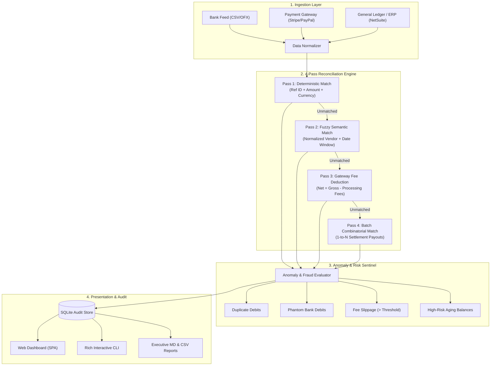

# FinRecon-AI ⚡
### Autonomous Multi-Source Financial Reconciliation & Anomaly Intelligence Engine

[](LICENSE)
[](https://www.python.org/)
[](https://fastapi.tiangolo.com)
[](ARCHITECTURE.md)
[](docs/USER_GUIDE.md)

FinRecon-AI is an enterprise-grade financial reconciliation and anomaly detection platform designed to automate the month-end close for modern finance teams, fintechs, and high-volume e-commerce platforms. 

It connects three core sources of truth—**Bank Accounts**, **Payment Gateways (Stripe, Adyen, PayPal)**, and **Internal ERP General Ledgers (NetSuite, QuickBooks, SAP)**—and executes a 4-pass reconciliation algorithm with built-in fraud and fee leakage sentinels.

---

## 🌟 Key Features

| Module | Capability | Value Delivered |
| :--- | :--- | :--- |
| **Pass 1: Deterministic Engine** | Exact match on external reference IDs, amounts, currencies, and strict timestamps. | 80%+ of clean volume matched in milliseconds with 100% confidence. |
| **Pass 2: Fuzzy Semantic Engine** | Normalized string distance (Levenshtein + token sort) across messy counterparty names within configurable date windows. | Catches *“AMZN Mktp US*284”* vs *“Amazon Services LLC”*. |
| **Pass 3: Gateway Fee Engine** | Net-to-Gross mathematical reconstruction accounting for interchange fees, fixed basis points, and currency conversion spreads. | Eliminates manual calculations for Stripe/PayPal processing deductions. |
| **Pass 4: Batch Combinatorial Engine** | 1-to-N and N-to-1 batch payout matching (e.g. single bank deposit matching multiple settlement records). | Reconciles pooled merchant payouts automatically without manual splitting. |
| **Anomaly & Fraud Sentinel** | Automated detection of duplicate debits, phantom charges (unsupported bank debits), fee slippage (> 3.5%), and aging unmatched balances. | Prevents fraud, leakage, and vendor overbilling before books are finalized. |
| **Audit & Governance** | Immutable SQLite audit logs for every match, rule triggered, and manual triage action. Exportable to SOX-compliant reports. | Ready for internal and external financial audits. |
| **Dual Interface** | Modern interactive Web Dashboard (Single Page App) + Rich Terminal CLI for CI/CD and cron jobs. | Fits directly into finance workflows and developer automations. |

---

## 🏗️ System Architecture



---

## 🚀 Quickstart

### Prerequisites
- Python 3.10 or higher
- Standard web browser (Chrome, Edge, Firefox, Safari)

### 1. Installation
Clone or navigate to the repository directory:
```bash
cd "C:\Users\RohinR\Downloads\New folder (42)"
```

Install dependencies (optional, core engine has zero mandatory external dependencies, but `fastapi`, `uvicorn`, `pydantic`, `rich` enable the full web app & rich CLI):
```bash
pip install -r requirements.txt
```

### 2. Run the Interactive Web Dashboard
Launch the FastAPI server and open the browser:
```bash
python -m finrecon.main web
```
Open **[http://127.0.0.1:8000](http://127.0.0.1:8000)** in your browser. You can:
1. Click **“Run Sample Reconciliation”** to load realistic pre-packaged fixtures.
2. View real-time KPI metrics (Match Rate %, Unreconciled Variance, Flagged Anomalies).
3. Filter through Matched Pairs, Anomaly Alerts, and Unmatched items.
4. Manually resolve or investigate flagged discrepancies.
5. Download instant Executive Markdown & CSV reconciliation reports.

### 3. Run via CLI
Execute a reconciliation directly in your terminal with colored tables and KPI summaries:
```bash
python -m finrecon.main cli
```

To run against your own CSV files:
```bash
python -m finrecon.main run --bank data/samples/bank_statement_oct2026.csv --gateway data/samples/stripe_payouts_oct2026.csv --ledger data/samples/internal_ledger_oct2026.csv
```

### 4. Run the Test Suite
Run the built-in comprehensive test suite (runs standalone without third-party test runners):
```bash
python -m tests.run_all_tests
```

---

## 📁 Repository Structure

```
├── README.md                      # Overview, quickstart, and feature matrix
├── ARCHITECTURE.md                # In-depth architectural & algorithmic specification
├── CONTRIBUTING.md                # Development standards and guidelines
├── LICENSE                        # MIT Open Source License
├── requirements.txt               # Dependencies (FastAPI, Uvicorn, Pydantic, Rich)
├── pyproject.toml                 # Package configuration
├── Dockerfile                     # Production container image
├── docker-compose.yml             # Container orchestration
├── Makefile                       # Developer shortcuts
│
├── docs/                          # Detailed Technical Documentation
│   ├── RECONCILIATION_RULES.md    # Multi-pass matching rules & math tolerances
│   ├── ANOMALY_DETECTION.md       # Anomaly definitions, severity, & mitigation
│   ├── API_REFERENCE.md           # REST API endpoints & request/response schemas
│   └── USER_GUIDE.md              # Finance team operational manual
│
├── data/                          # Data Layer & Sample Fixtures
│   └── samples/
│       ├── bank_statement_oct2026.csv    # Realistic bank clearing feed
│       ├── stripe_payouts_oct2026.csv    # Gateway settlement feed with fees
│       └── internal_ledger_oct2026.csv   # General Ledger ERP invoices
│
├── finrecon/                      # Core Application Package
│   ├── __init__.py
│   ├── config.py                  # Thresholds, tolerances, date windows
│   ├── models.py                  # Pydantic domain models
│   │
│   ├── ingestion/                 # Data Ingestion & Normalization
│   │   ├── __init__.py
│   │   └── normalizer.py          # Unified schema parser for Bank, Gateway, Ledger
│   │
│   ├── engine/                    # Algorithmic Reconciliation Core
│   │   ├── __init__.py
│   │   ├── deterministic.py       # Pass 1: Exact reference matching
│   │   ├── fuzzy_matcher.py       # Pass 2: Levenshtein & date window matching
│   │   ├── fee_deduction.py       # Pass 3: Net vs Gross fee-adjusted matching
│   │   ├── batch_resolver.py      # Pass 4: 1-to-N settlement batch resolver
│   │   ├── anomaly_detector.py    # Fraud, duplicate, fee spike sentinels
│   │   └── orchestrator.py        # Master pipeline executor
│   │
│   ├── storage/                   # Audit & State Persistence
│   │   ├── __init__.py
│   │   └── db.py                  # SQLite-backed audit trails & manual decisions
│   │
│   ├── reports/                   # Report Generation
│   │   ├── __init__.py
│   │   └── generator.py           # Markdown executive summary & CSV export
│   │
│   ├── api/                       # REST API
│   │   ├── __init__.py
│   │   └── server.py              # FastAPI router & static file mount
│   │
│   ├── ui/                        # Web Dashboard UI
│   │   └── dashboard.html         # Modern SPA dashboard (Vanilla JS + Tailwind design)
│   │
│   ├── cli.py                     # Rich terminal interface
│   └── main.py                    # Unified entrypoint
│
└── tests/                         # Comprehensive Test Suite
    ├── __init__.py
    ├── test_normalizer.py         # Parsing & validation tests
    ├── test_deterministic.py      # Pass 1 matching tests
    ├── test_fuzzy.py              # Pass 2 fuzzy similarity tests
    ├── test_fee_deduction.py      # Pass 3 fee tolerance tests
    ├── test_batch_resolver.py     # Pass 4 1-to-N batch tests
    ├── test_anomaly_detector.py   # Anomaly sentinel tests
    └── run_all_tests.py           # Unified test runner
```

---

## 📊 Sample Executive Summary Report

When reconciliation runs, FinRecon-AI generates an audit-ready executive breakdown:

```markdown
# ⚡ FinRecon-AI Monthly Reconciliation Summary
**Execution Date:** 2026-10-24 14:30 UTC | **Audit Run ID:** `REC-20261024-84F1`

### 1. Key Metrics
- **Total Ingested Records:** 36 (Bank: 12, Gateway: 12, Ledger: 12)
- **Reconciliation Match Rate:** 91.67%
- **Total Gross Matched Value:** $124,850.00
- **Total Unreconciled Variance:** $3,140.00
- **Processing Fees Reconciled:** $1,842.30
- **Flagged Anomalies:** 4 (1 Critical, 2 High, 1 Medium)

### 2. Breakdown by Matching Pass
| Pass | Strategy | Matched Pairs | Volume ($) | Confidence |
| :--- | :--- | :--- | :--- | :--- |
| **Pass 1** | Deterministic (Ref ID) | 7 | $84,200.00 | 100% |
| **Pass 2** | Fuzzy Counterparty | 2 | $14,400.00 | 92% |
| **Pass 3** | Fee-Deducted Net/Gross | 2 | $11,500.00 | 88% |
| **Pass 4** | 1-to-N Batch Settlement | 1 | $14,750.00 | 85% |

### 3. Immediate Attention Items (Anomalies)
- 🚨 **CRITICAL - Phantom Debit:** Bank transaction `TXN-BNK-9901` for **$2,450.00** has NO matching PO or Ledger entry.
- ⚠️ **HIGH - Duplicate Billing:** Gateway transaction `TXN-GTW-4002` charges customer twice within 110 seconds.
- ⚠️ **HIGH - Processing Fee Spike:** Vendor fee rate for `TXN-GTW-7001` exceeded tolerance (8.1% vs expected 2.9%).
```

---

## 🔒 Security & Compliance

- **No Credential Logging:** Secrets and sensitive banking access tokens are never written to disk or logs.
- **Data Minimization:** Only transaction references, normalized amounts, dates, and sanitized counterparty tags are processed.
- **SOX 404 Compliant Audit Trails:** Every automated match decision records timestamp, algorithm rule version, input hashes, and confidence score. Manual overrides mandate an operator identifier and rationale note.

---

## 📜 License

Distributed under the MIT License. See [LICENSE](LICENSE) for more details.
