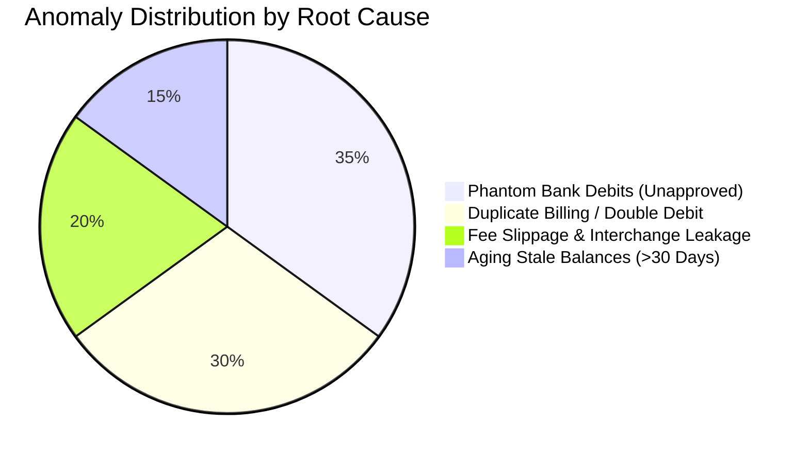

# FinRecon-AI: Anomaly & Fraud Sentinel Specification

## 1. Overview

While traditional reconciliation systems merely report what matched, FinRecon-AI actively hunts for **financial anomalies, accounting errors, and fraud vectors**. 

The Anomaly Sentinel runs continuously across both matched pairs and residual unmatched items, scoring every entity against risk rules and assigning clear severity tags (`CRITICAL`, `HIGH`, `MEDIUM`, `LOW`).

---

## 2. Taxonomy of Detected Anomalies



---

### Anomaly 1: Phantom Bank Debits (`CRITICAL`)
* **Definition:** A debit transaction appears on the Bank Statement that has no corresponding Purchase Order, Vendor Bill, or General Ledger entry.
* **Risk Factor:** Unauthorized account access, business email compromise (BEC), unrecorded supplier liabilities, or forgotten automated renewals.
* **Detection Rule:**
  $$\text{Source} = \text{BANK} \quad \land \quad \text{Amount} < 0 \quad \land \quad \text{Status} = \text{UNMATCHED} \quad \land \quad \text{Age} \ge 3 \text{ days}$$
* **Remediation Action:** Triggers immediate Slack/Email alert to the corporate treasury lead and freezes ledger closing until validated.

---

### Anomaly 2: Duplicate Charges & Double Debits (`HIGH`)
* **Definition:** The same customer or vendor is billed identical amounts within a rapid timeframe, or two identical debits clear the bank account consecutively.
* **Risk Factor:** Webhook retry loop in payment gateway, accidental double-click at checkout, or duplicate invoice submission by vendor.
* **Detection Rule:**
  $$\text{Counterparty}_1 = \text{Counterparty}_2 \quad \land \quad |\text{Amount}_1| = |\text{Amount}_2| \quad \land \quad |\text{Timestamp}_1 - \text{Timestamp}_2| \le 180 \text{ seconds}$$
  *(Also triggered if identical amounts clear on the exact same date with different synthetic transaction IDs).*
* **Remediation Action:** Flags for automated chargeback prevention or instant vendor credit memo request.

---

### Anomaly 3: Fee Slippage & Processor Take-Rate Spikes (`HIGH` / `MEDIUM`)
* **Definition:** The effective fee deducted by a payment gateway or acquiring bank exceeds the negotiated contractual rate.
* **Risk Factor:** Silent processor rate increases, non-qualified card interchange surcharges (commercial cards, international fees), or foreign exchange spread markups.
* **Detection Rule:**
  $$\text{EffectiveFeeRate} = \frac{|\text{Fee}|}{|\text{GrossAmount}|} > \theta_{\text{fee\_max}} \quad (\text{Default: } 3.5\%)$$
* **Remediation Action:** Categorized into a Merchant Services Dispute Queue with calculated overcharge dollar totals.

---

### Anomaly 4: High-Risk Aging Unreconciled Balances (`MEDIUM`)
* **Definition:** Items that remain unmatched beyond standard accounting closing cycles.
* **Risk Factor:** Incomplete revenue recognition, bad debt, or uncashed vendor checks.
* **Tiers:**
  * **Tier 1 (15 - 30 days):** Warning state (`LOW` severity).
  * **Tier 2 (> 30 days):** Material discrepancy (`MEDIUM` severity) requiring reserve provisioning.

---

## 3. Severity Matrix & Action Escalation

| Severity | Color | SLA | Example Incident | Automated Action |
| :--- | :--- | :--- | :--- | :--- |
| **CRITICAL** | 🔴 Red | 4 Hours | \$2,450 wire debit with zero PO or invoice. | Treasury webhook alert; blocks monthly close export. |
| **HIGH** | 🟠 Orange | 24 Hours | Customer double-billed \$499.00 within 2 minutes. | Drafts refund ticket; flags transaction in dashboard. |
| **MEDIUM** | 🟡 Yellow | 3 Days | Stripe fee of 8.1% on a \$1,200 transaction. | Adds to monthly processor dispute reconciliation file. |
| **LOW** | 🔵 Blue | 7 Days | Minor \$0.12 rounding drift on foreign currency conversion. | Logs to automated rounding adjustment account. |

---

## 4. Anomaly Output Data Schema

```json
{
  "anomaly_id": "ANOM-20261024-91",
  "anomaly_type": "PHANTOM_DEBIT",
  "severity": "CRITICAL",
  "transaction_id": "TXN-BNK-9901",
  "source": "BANK",
  "amount": -2450.00,
  "currency": "USD",
  "counterparty": "UNKNOWN WIRE TRF NYC",
  "date": "2026-10-14",
  "description": "Bank debit cleared with no corresponding invoice in ERP ledger or AP records.",
  "recommended_action": "Verify with treasury whether an out-of-band wire was issued. If unapproved, notify bank fraud team immediately.",
  "status": "OPEN",
  "detected_at": "2026-10-24T14:30:00Z"
}
```
